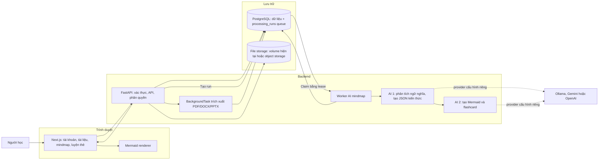
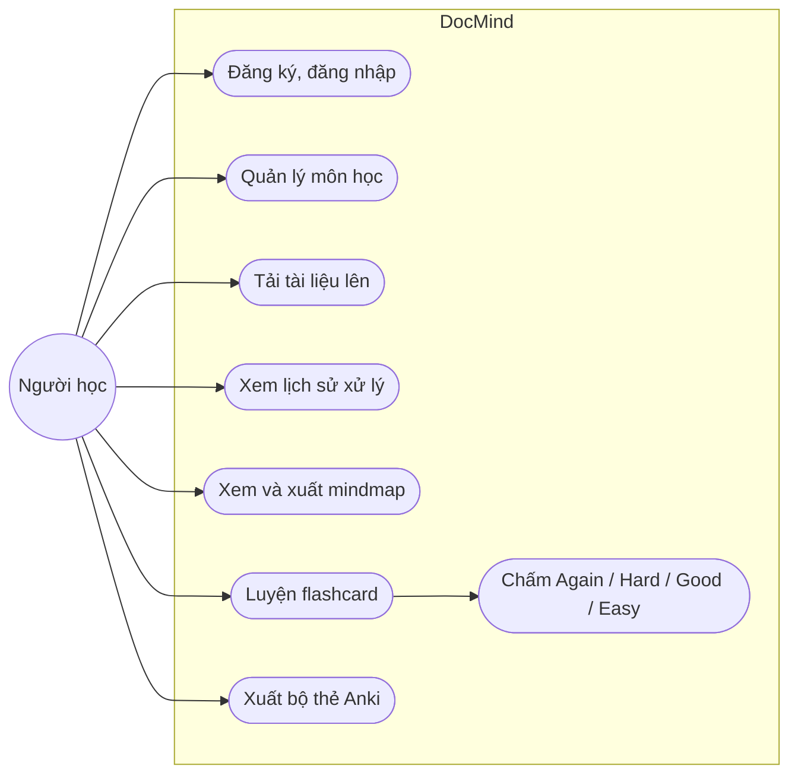
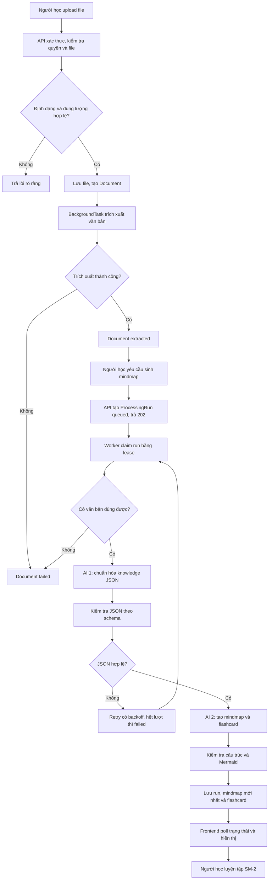
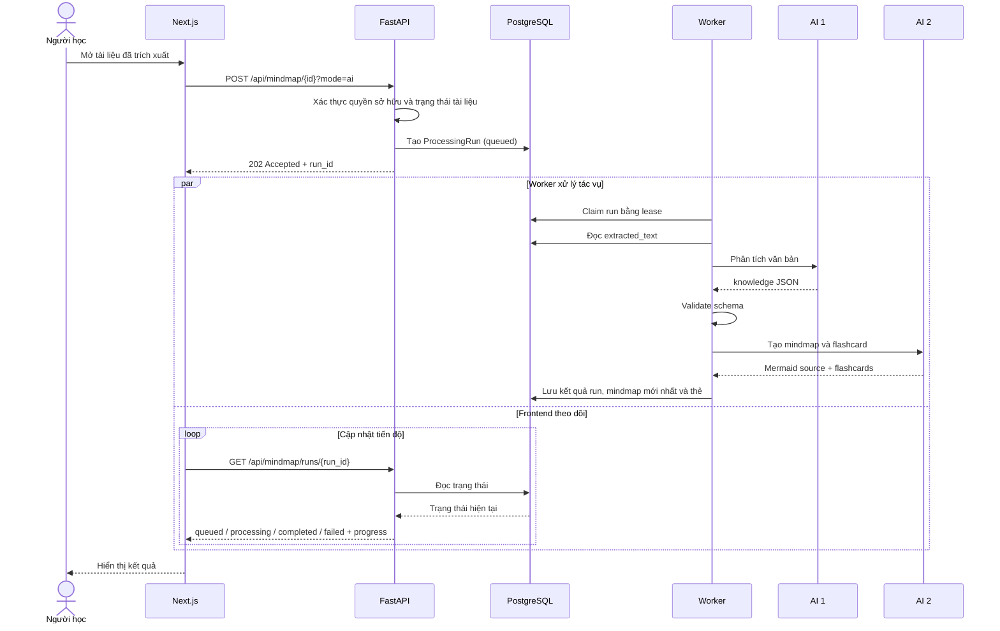
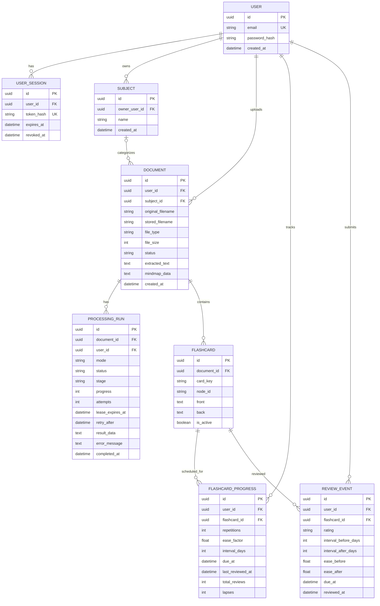
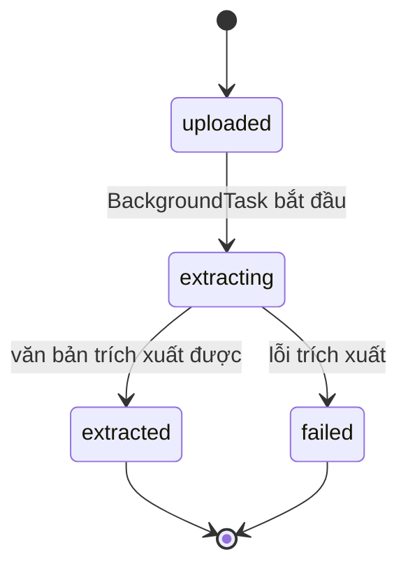
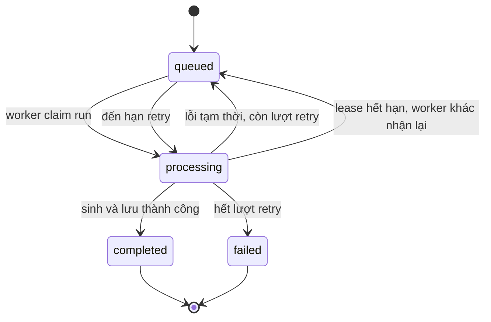
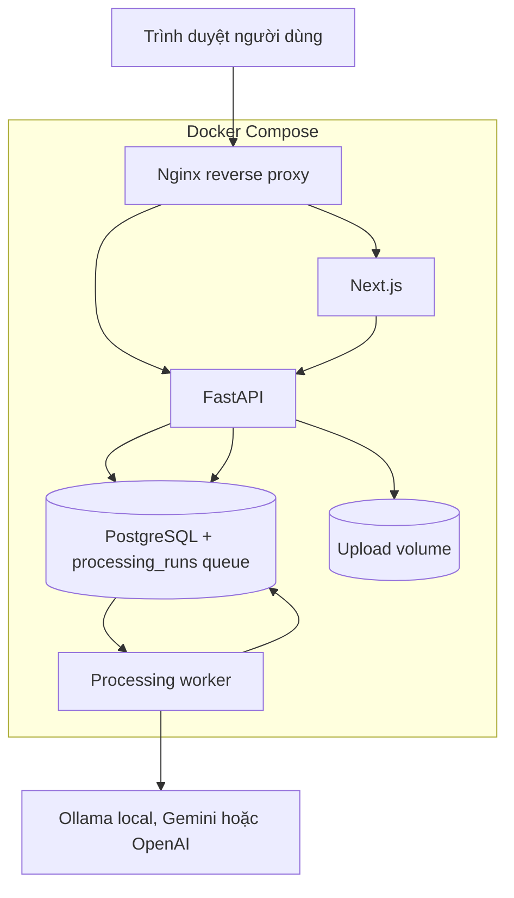
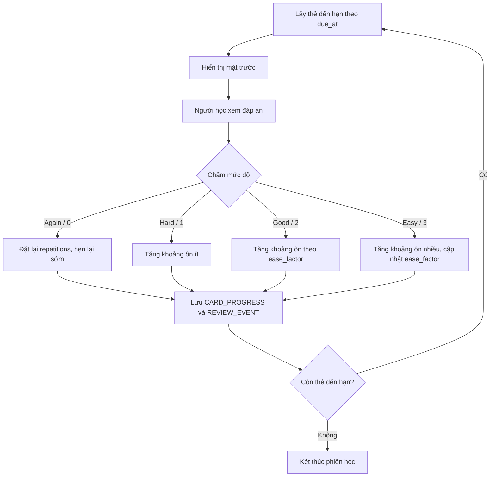

# DocMind: kiến trúc mục tiêu và lộ trình hoàn thiện

Tài liệu này đối chiếu kiến trúc đang có trong code với phần còn lại cần hoàn thiện. Các sơ đồ ghi rõ phần nào đang chạy và phần nào là mục tiêu tiếp theo.

## 1. Hiện trạng và đích đến

| Khu vực | Hiện trạng trong repo | Đích đến |
|---|---|---|
| Giao diện và API | Next.js, FastAPI, PostgreSQL; có đăng ký/đăng nhập bằng cookie phiên | Giữ nền tảng hiện có |
| Tài liệu | Upload PDF/DOCX/PPTX, trích xuất văn bản bằng BackgroundTasks, phân quyền theo chủ sở hữu, gắn/lọc môn học | Đưa cả trích xuất vào worker bền vững; thêm OCR tùy nhu cầu |
| AI | Engine cấu trúc và pipeline hai bước; từng bước cấu hình Ollama, Gemini hoặc OpenAI | Theo dõi chi phí và giới hạn sử dụng provider |
| Mindmap | Mermaid renderer có zoom/pan, tải `.mmd`/SVG, in PDF; sơ đồ tùy biến có PNG/SVG; xem và xuất snapshot cũ từ giao diện | Cho phép API xuất trực tiếp một run đã chọn |
| Flashcard | Có luyện Again/Hard/Good/Easy theo SM-2; tiến độ và review log lưu riêng; xuất `.apkg` | Thống kê học tập và bộ thẻ gắn với từng phiên bản |
| Tác vụ nền | Pipeline mindmap dùng hàng đợi PostgreSQL, worker riêng, lease, tiến độ, retry có backoff và lịch sử run | Đưa trích xuất file vào worker và hoàn thiện vận hành production |

Migrations tạo bảng người dùng, phiên và môn học. Các tài liệu cũ chưa có chủ sở hữu được giữ ở trạng thái mồ côi để không tự động lộ dữ liệu cho tài khoản mới; chúng không xuất hiện trong danh sách của người dùng.

## 2. Sơ đồ kiến trúc hiện tại và hướng mở rộng



**Hiện trạng:** upload vẫn trích xuất văn bản bằng BackgroundTasks trong tiến trình API. Khi tài liệu đã trích xuất, pipeline mindmap chạy qua worker riêng; provider/model cấu hình riêng cho từng bước; mặc định Ollama local. Kết quả và tiến độ được giữ trong `processing_runs`, kết quả mới nhất đồng thời lưu trong `mindmap_data`; flashcard được lưu riêng.

**Nguyên tắc còn lại:** giữ khóa AI ở backend; chuyển cả trích xuất tài liệu sang worker bền vững nếu cần độ tin cậy cao hơn.

## 3. Sơ đồ chức năng người học



## 4. Workflow tạo mindmap qua hai AI

Upload và trích xuất văn bản xảy ra trước. Người dùng chỉ yêu cầu sinh mindmap khi tài liệu ở trạng thái extracted. API tạo ProcessingRun rồi trả về ngay; worker đọc văn bản đã trích xuất, chạy lần lượt hai AI và ghi kết quả.



### Hợp đồng dữ liệu giữa các bước

```json
{
  "document_id": "uuid",
  "knowledge": {
    "title": "Tên bài học",
    "summary": "Tóm tắt ngắn",
    "sections": [
      {
        "heading": "Khái niệm chính",
        "level": 1,
        "summary": "Ý chính của mục",
        "facts": ["Thông tin có trong tài liệu"]
      }
    ]
  },
  "mindmap": {"nodes": [{"id": "n1", "label": "Ý chính", "description": "", "parent_id": null}]},
  "mermaid": "mindmap\n  root((Tên bài học))",
  "flashcards": [{"front": "Câu hỏi", "back": "Câu trả lời", "node_id": "n1"}]
}
```

Code xác thực các trường AI bằng Pydantic trước khi lưu; sơ đồ trên minh họa kết quả đã chuẩn hóa và tương thích frontend.

## 5. Sơ đồ tuần tự tạo kết quả



## 6. ERD hiện tại

`FLASHCARD_PROGRESS` là trạng thái ôn hiện tại của một người dùng với một thẻ. `REVIEW_EVENT` giữ lịch sử từng lần chấm để thống kê và kiểm tra lịch sử học.



Trong code hiện tại, thẻ gắn với tài liệu và được cập nhật theo nội dung; mỗi run lưu snapshot kết quả riêng trong `result_data`. Tiến độ thẻ có khóa chính UUID và ràng buộc duy nhất theo cặp user/thẻ. `mindmap_data` trên document giữ kết quả mới nhất để API và giao diện đọc thuận tiện.

## 7. Trạng thái tài liệu và tác vụ mindmap





## 8. Docker Compose hiện tại



Worker được khai báo trong Compose và chỉ khởi động sau khi backend hoàn tất migration và healthcheck thành công. PostgreSQL vừa lưu trạng thái vừa làm hàng đợi; lease và FOR UPDATE SKIP LOCKED hỗ trợ worker nhận việc an toàn và phục hồi sau khi tiến trình dừng đột ngột.

## 9. Luồng luyện flashcard SM-2



## 10. Lộ trình thực hiện

### Bước 1: Làm cho nền tảng hiện tại chạy ổn định

- Sửa Dockerfile frontend để không phụ thuộc vào file `package-lock.json` hoặc thư mục `public` không có trong repo.
- Chốt URL API cho môi trường local và môi trường triển khai.
- Đảm bảo giới hạn upload được áp dụng khi đọc dữ liệu, tránh nạp file không giới hạn vào RAM.

**Hoàn tất khi:** frontend và backend dựng được bằng Compose, upload tài liệu hợp lệ và xem được trạng thái xử lý.

### Bước 2: Tài khoản, môn học và quyền sở hữu — đã triển khai phần nền

- Tạo bảng `users`, API đăng ký/đăng nhập và cơ chế lưu phiên hoặc token.
- Tạo API CRUD môn học.
- Gắn tài liệu với chủ sở hữu; kiểm tra quyền trên mọi API xem, xóa, tải xuống và tạo mindmap.
- Thêm bộ lọc lịch sử theo môn học.

Đã có đăng ký/đăng nhập, phiên cookie HTTPOnly, CRUD môn học và lọc tài liệu theo chủ sở hữu. Cần kiểm tra luồng hai tài khoản và bổ sung quản lý/khôi phục tài khoản trước khi coi phần này sẵn sàng production.

**Hoàn tất khi:** hai tài khoản khác nhau không thể xem hoặc xóa tài liệu của nhau; người dùng có thể khôi phục tài khoản an toàn.

### Bước 3: Đưa pipeline AI sang worker bền vững — nền tảng đã có

- Pipeline đồng bộ hai bước đã có: AI 1 chuẩn hóa kiến thức; AI 2 tạo mindmap, Mermaid và flashcard.
- Provider mỗi bước có thể chọn Ollama, Gemini hoặc OpenAI; API key chỉ ở backend.
- JSON đầu ra được kiểm tra schema và kết quả lưu trong `mindmap_data`.
- Đã có processing_runs, worker riêng, tiến độ, lease phục hồi sau crash, retry có backoff và polling từ giao diện.
- Kết quả của từng run được lưu; còn cần giao diện duyệt/chọn các phiên bản cũ.

**Hoàn tất khi:** pipeline chạy nền; tài liệu có thể thử lại và xem tiến độ; lỗi AI không làm mất file hoặc văn bản đã trích xuất.

### Bước 4: Hoàn thiện mindmap — chức năng chính đã có

- Đã thêm Mermaid renderer với zoom, pan, tải `.mmd`/SVG và in ra PDF.
- Sơ đồ SVG hiện có hỗ trợ tải PNG và SVG.
- Giao diện có thể chọn snapshot cũ; API export theo document vẫn trả kết quả mới nhất.

**Hoàn tất khi:** người học chọn được snapshot cũ và xuất đúng sơ đồ đang xem.

### Bước 5: Hoàn thiện flashcard và SM-2

- Đã có bảng flashcard, tiến độ theo tài khoản và log từng lần đánh giá.
- Đã có Again/Hard/Good/Easy, tính `due_at`, danh sách thẻ đến hạn và giao diện luyện tập.
- Đã có bộ xuất `.apkg` tương thích Anki.
- Còn cần thống kê học tập, lọc phiên ôn theo môn và thiết lập số thẻ mỗi ngày.

**Hoàn tất khi:** lịch ôn vẫn đúng sau khi đăng xuất/đăng nhập và tải lại trang; file Anki mở được trong Anki với câu hỏi và đáp án.

### Bước 6: Hoàn thiện an toàn và vận hành

- Bổ sung OCR nếu cần xử lý PDF scan.
- Thêm log theo `document_id`/`processing_run_id`, giới hạn tốc độ và dọn file tạm.
- Cập nhật README, cấu hình production, backup dữ liệu và cách migrate database.

## 11. Trình tự bắt đầu trong repo

1. Dùng sơ đồ ERD mục tiêu để chốt entity và quan hệ trước khi viết migration.
2. Nền tảng tài khoản, quyền sở hữu và môn học đã có; kiểm tra luồng với hai tài khoản.
3. Pipeline AI hai bước, worker bền vững và tải mã Mermaid đã có.
4. Mermaid renderer, xuất từ giao diện và danh sách snapshot run đã có.
5. Lịch SM-2 và xuất Anki đã được nối; bổ sung thống kê học tập sau khi worker và Mermaid renderer hoàn tất.

Các sơ đồ Mermaid có thể xem trực tiếp trên GitLab/GitHub hoặc trong editor có hỗ trợ Mermaid. Khi cấu trúc hệ thống thay đổi, cập nhật sơ đồ và migration cùng một lần.
